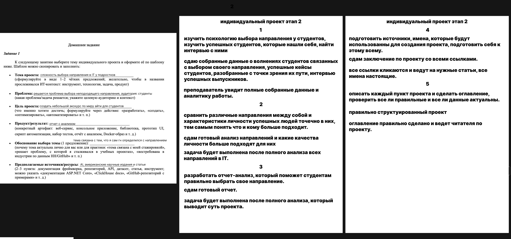
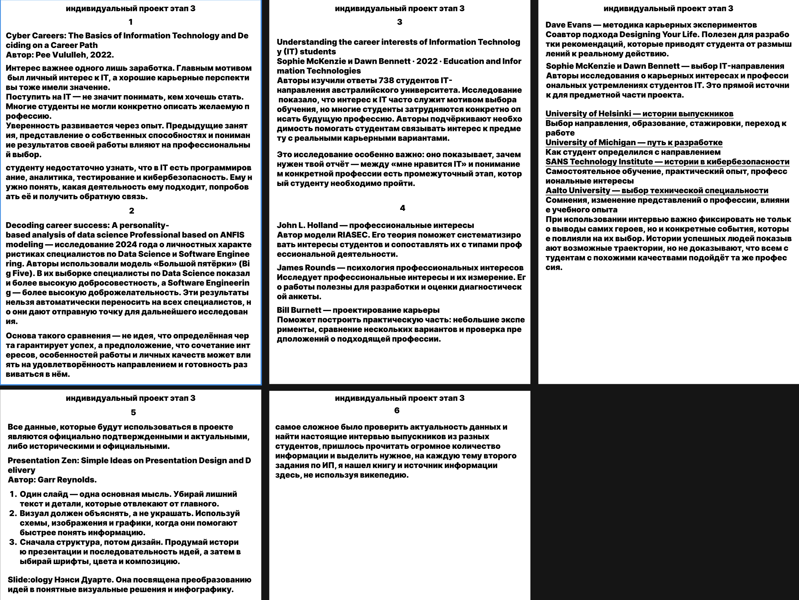

<div align="center">

# 🎓 Индивидуальный проект
### Выбор направления в IT

Материалы проекта о том, как помочь подросткам и студентам определиться с направлением в IT.

**3 этапа · Условия и решения · Анализ источников**

</div>

---

## О проекте

**Проблема:** выбор неподходящего направления обучения и профессионального развития в IT.

**Цель:** подготовить обзор IT-направлений, который поможет студентам лучше понять свои интересы и возможные карьерные пути.

**Планируемый результат:** отчёт с анализом направлений, профессиональных интересов и опыта студентов и выпускников.

В репозитории собраны учебные материалы: задания и соответствующие им решения. Это документация индивидуального проекта, а не готовое приложение.

## 🧭 Навигация

| Этап | Содержание | Задание | Решение |
| :--- | :--- | :---: | :---: |
| **01** | Выбор темы и паспорт проекта | [PDF](stages/stage-01/task.pdf) | [DNG](stages/stage-01/solution.dng) |
| **02** | Постановка задач | [PDF](stages/stage-02/task.pdf) | [PNG](stages/stage-02/solution.png) |
| **03** | Анализ литературы и источников | [PDF](stages/stage-03/task.pdf) | [PNG](stages/stage-03/solution.png) |

---

## 01 · Выбор темы и паспорт проекта

Первый этап посвящён выбору темы, формулировке проблемы, цели и ожидаемого результата, а также подбору предполагаемых источников.

### Условие

[Открыть исходное задание в PDF](stages/stage-01/task.pdf)


### Решение

[Открыть исходный файл решения первого этапа (DNG)](stages/stage-01/solution.dng)

> Файл DNG оставлен в исходном формате. Его содержимое не проверено; превью не добавлено.

---

## 02 · Постановка задач

Второй этап раскрывает план работы: изучение профессионального выбора студентов, сравнение IT-направлений, подготовку отчёта, подбор источников и структурирование материалов.

### Условие

[Открыть исходное задание в PDF](stages/stage-02/task.pdf)


### Решение

[Открыть решение в полном размере](stages/stage-02/solution.png)



> В исходном изображении второго этапа слева также показан паспорт проекта; постановка задач расположена в центральной и правой частях.

---

## 03 · Анализ литературы и источников

Третий этап содержит обзор материалов о карьерных интересах, личностных особенностях, выборе IT-направления и опыте выпускников, а также заметки об оформлении презентации.

### Условие

[Открыть исходное задание в PDF](stages/stage-03/task.pdf)


### Решение

[Открыть решение в полном размере](stages/stage-03/solution.png)



---

## 📂 Структура проекта

```text
.
├── README.md
├── stages/
│   ├── stage-01/
│   │   ├── task.pdf
│   │   └── solution.dng
│   ├── stage-02/
│   │   ├── task.pdf
│   │   └── solution.png
│   └── stage-03/
│       ├── task.pdf
│       └── solution.png
└── assets/
    ├── readme/
    │   ├── stage-1.png
    │   ├── stage-2.png
    │   └── stage-3.png
    └── reference/
        └── project-cover.jpg
```

- `stages/` — оригинальные материалы каждого этапа;
- `assets/readme/` — превью условий для отображения в README;
- `assets/reference/` — дополнительный исходный визуальный материал;
- `README.md` — описание проекта и навигация.

Исходные файлы не удалены, а разложены по тематическим папкам и переименованы в понятный формат.
