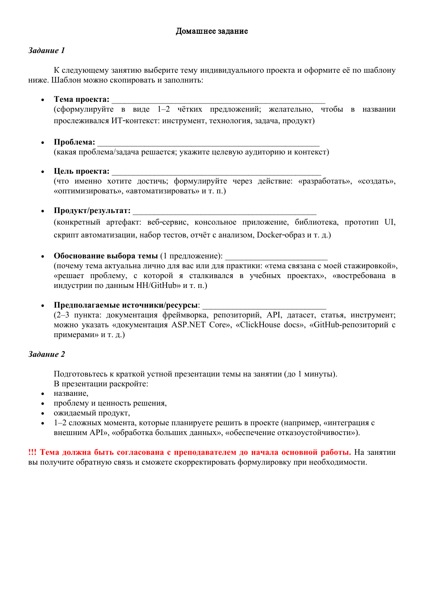
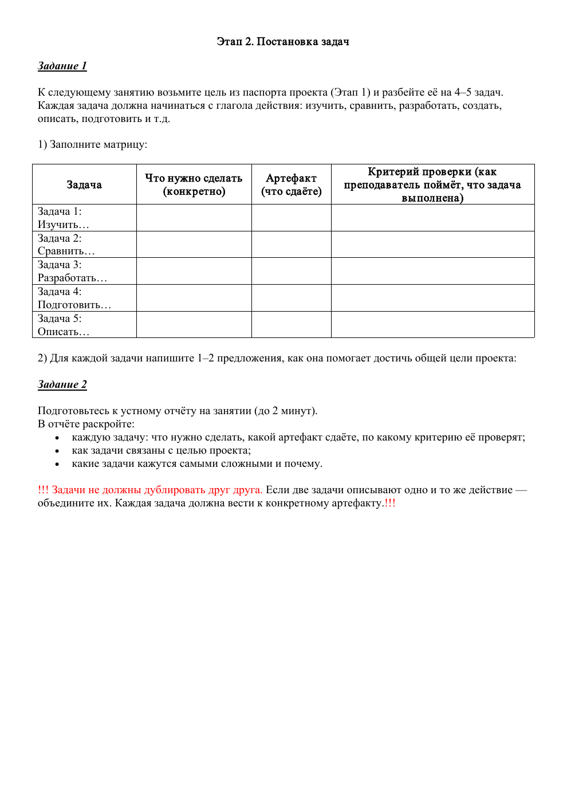
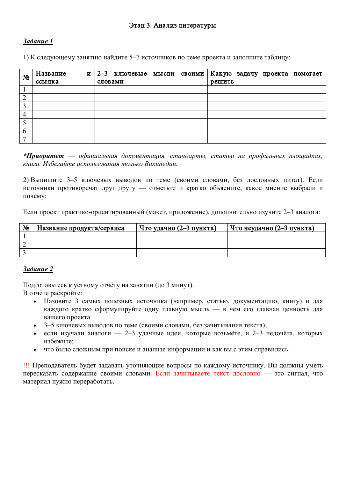

<div align="center">

# 🎓 Индивидуальный проект
### Выбор направления в IT

Материалы проекта о том, как помочь подросткам и студентам определиться с направлением в IT.

**3 этапа · Условия и решения · Анализ источников**

</div>

---

## О проекте

**Проблема:** выбор неподходящего направления обучения и профессионального развития в IT.

**Цель:** подготовить обзор IT-направлений, который поможет студентам лучше понять свои интересы и возможные карьерные пути.

**Планируемый результат:** отчёт с анализом направлений, профессиональных интересов и опыта студентов и выпускников.

В репозитории собраны учебные материалы: задания и соответствующие им решения. Это документация индивидуального проекта, а не готовое приложение.

## 🧭 Навигация

| Этап | Содержание | Задание | Решение |
| :--- | :--- | :---: | :---: |
| **01** | Выбор темы и паспорт проекта | [PDF](%D0%BF%D0%B5%D1%80%D0%B2%D1%8B%D0%B9%20%D1%8D%D1%82%D0%B0%D0%BF.pdf) | [DNG](%D1%80%D0%B5%D1%88%D0%B5%D0%BD%D0%B8%D0%B5%20%D0%BF%D0%B5%D1%80%D0%B2%D0%BE%D0%B3%D0%BE%20%D1%8D%D1%82%D0%B0%D0%BF%D0%B0.dng) |
| **02** | Постановка задач | [PDF](%D0%B2%D1%82%D0%BE%D1%80%D0%BE%D0%B9%20%D1%8D%D1%82%D0%B0%D0%BF.pdf) | [PNG](%D1%80%D0%B5%D1%88%D0%B5%D0%BD%D0%B8%D0%B5%20%D0%B2%D1%82%D0%BE%D1%80%D0%BE%D0%B3%D0%BE%20%D1%8D%D1%82%D0%B0%D0%BF%D0%B0.png) |
| **03** | Анализ литературы и источников | [PDF](%D1%82%D1%80%D0%B5%D1%82%D0%B8%D0%B9%20%D1%8D%D1%82%D0%B0%D0%BF.pdf) | [PNG](%D1%80%D0%B5%D1%88%D0%B5%D0%BD%D0%B8%D0%B5%20%D1%82%D1%80%D0%B5%D1%82%D1%8C%D0%B5%D0%B3%D0%BE%20%D1%8D%D1%82%D0%B0%D0%BF%D0%B0.png) |

---

## 01 · Выбор темы и паспорт проекта

Первый этап посвящён выбору темы, формулировке проблемы, цели и ожидаемого результата, а также подбору предполагаемых источников.

### Условие

[Открыть исходное задание в PDF](%D0%BF%D0%B5%D1%80%D0%B2%D1%8B%D0%B9%20%D1%8D%D1%82%D0%B0%D0%BF.pdf)



### Решение

[Открыть исходный файл решения первого этапа (DNG)](%D1%80%D0%B5%D1%88%D0%B5%D0%BD%D0%B8%D0%B5%20%D0%BF%D0%B5%D1%80%D0%B2%D0%BE%D0%B3%D0%BE%20%D1%8D%D1%82%D0%B0%D0%BF%D0%B0.dng)

> Файл DNG оставлен в исходном формате. Его содержимое не проверено; превью не добавлено.

---

## 02 · Постановка задач

Второй этап раскрывает план работы: изучение профессионального выбора студентов, сравнение IT-направлений, подготовку отчёта, подбор источников и структурирование материалов.

### Условие

[Открыть исходное задание в PDF](%D0%B2%D1%82%D0%BE%D1%80%D0%BE%D0%B9%20%D1%8D%D1%82%D0%B0%D0%BF.pdf)



### Решение

[Открыть решение в полном размере](%D1%80%D0%B5%D1%88%D0%B5%D0%BD%D0%B8%D0%B5%20%D0%B2%D1%82%D0%BE%D1%80%D0%BE%D0%B3%D0%BE%20%D1%8D%D1%82%D0%B0%D0%BF%D0%B0.png)


> В исходном изображении второго этапа слева также показан паспорт проекта; постановка задач расположена в центральной и правой частях.

---

## 03 · Анализ литературы и источников

Третий этап содержит обзор материалов о карьерных интересах, личностных особенностях, выборе IT-направления и опыте выпускников, а также заметки об оформлении презентации.

### Условие

[Открыть исходное задание в PDF](%D1%82%D1%80%D0%B5%D1%82%D0%B8%D0%B9%20%D1%8D%D1%82%D0%B0%D0%BF.pdf)



### Решение

[Открыть решение в полном размере](%D1%80%D0%B5%D1%88%D0%B5%D0%BD%D0%B8%D0%B5%20%D1%82%D1%80%D0%B5%D1%82%D1%8C%D0%B5%D0%B3%D0%BE%20%D1%8D%D1%82%D0%B0%D0%BF%D0%B0.png)


---

## 📂 Основные файлы

```text
.
├── README.md
├── первый этап.pdf
├── решение первого этапа.dng
├── второй этап.pdf
├── решение второго этапа.png
├── третий этап.pdf
├── решение третьего этапа.png
└── assets/
    └── readme/
        ├── stage-1.png
        ├── stage-2.png
        └── stage-3.png
```

PDF-файлы содержат оригинальные условия. Изображения в `assets/readme/` используются только для их просмотра прямо в README; исходные файлы сохранены без изменений.
